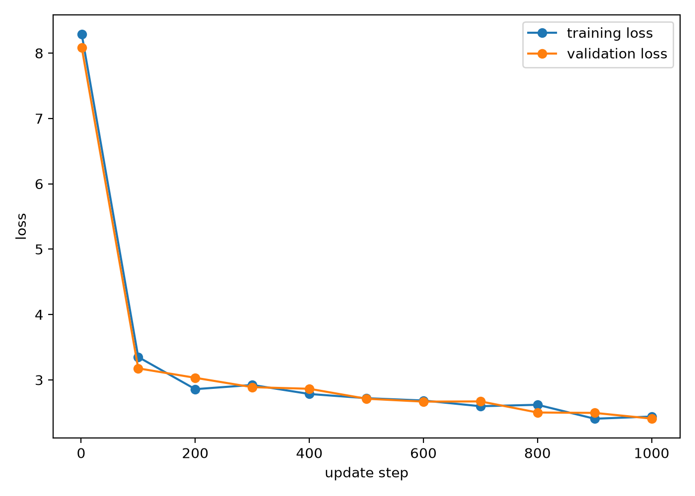

# Morpheme Tokenizer Run

```sh
uv run python src/final_project/morpheme_slm.py
```

This runs on the CPU, even if you have a GPU, so that every run gives exactly the same results. To use a GPU instead, set `deterministic = False` in `main` in `morpheme_slm.py`.

Use this to locally download 1000 tinyStories for the testing:
```sh
mkdir -p src/data
uv run python -c "from final_project.assignment3_slm_files.tinyStoriesPipeline import downloadTinyStoriesPrefix; print(downloadTinyStoriesPrefix('src/data/tinyStories.jsonl', size=10000))"
```

You may get an error, but check in the data folder, it may have downloaded anyway.

## Run (November 17, 2026)

This run uses `seed = 123` for every random choice in `morpheme_slm.py`: the train/validation/test split, the model's starting weights, the training batches, the validation batches, and the sampling of generated text. It runs on the CPU with `torch.use_deterministic_algorithms(True)` (`deterministic = True` in `main`).

**Running it twice gives exactly the same output.** We checked this by diffing the output of two runs. A run takes about 10 seconds on an Apple Silicon CPU.

### Setup

- **Data:** the first 1,000 stories of `src/data/tinyStories.jsonl`, split 800 / 100 / 100 into training, validation and test with seed 123.
- **Model:** `TransformerLM` with `n_embed=64`, `n_head=4`, `n_layer=2` and a context size of 32.
- **Training:** 1,000 steps of AdamW, batch size 16, learning rate 1e-3.
- **Evaluation:** the training loss is from the single batch at that step. The validation loss is averaged over 5 batches every 100 steps. Every evaluation uses the same 5 validation batches, so the validation losses at different steps are measured on the same text.

### Results

| Metric | Value |
|---|---|
| Vocabulary size | 3,146 |
| Validation loss at step 1 | 8.0781 (ln 3146 = 8.05, the loss of a uniform guess) |
| Final validation loss (step 1000) | 2.4578 |

| Step | Training loss | Validation loss |
|---|---|---|
| 1 | 8.2316 | 8.0781 |
| 100 | 3.2327 | 3.2263 |
| 200 | 2.9206 | 3.0308 |
| 300 | 2.9149 | 2.9413 |
| 400 | 2.8479 | 2.8803 |
| 500 | 2.8081 | 2.7955 |
| 600 | 2.6847 | 2.7151 |
| 700 | 2.6354 | 2.6550 |
| 800 | 2.3273 | 2.5881 |
| 900 | 2.4239 | 2.5191 |
| 1000 | 2.5252 | 2.4578 |



### Generated samples

Each sample starts from `<s>` and generates 50 tokens. Line breaks are sentence ends.

```text
sample 1:
Lily said, a big so friend.
iming Tom to be mom she skip and caught the sea and hurt it had Mr.
He
sample 2:
because it couldn't playdy on him.
Lily ran like his shocked on a time with ear to Lily things it.
She
sample 3:
It scareed to the rain dancing, "I Lila sending can can showed.
A not see for the living, but Timmy bad.
sample 4:
The little water laughed to do animals him for his relieveful.
He saw she curiouss, trouble orange was red why sees
sample 5:
Doething Lila felt fingerr, wear like the cat and importcareful they smiled in she in the sweet.
He tower me to
```

### Notes

- **The GPU isn't reproducible, even with a seed.** On the Mac GPU (MPS), two runs had the same split, vocabulary and losses up to step 200. After that the losses differed by about 0.001 and the generated samples were different. This is because the GPU doesn't always add floating point numbers in the same order. The CPU doesn't have this problem, and for a model this small it's also slightly faster (about 10 s on CPU against about 14 s on MPS). Setting `deterministic = False` in `main` goes back to the GPU.
- **Some generated words join a root with the wrong ending**, such as "scareed", "curiouss", "fingerr" and "relieveful". This likely comes from how roots ending in "e" are split: "scared" becomes `scare` + `d`, while "laughed" becomes `laugh` + `ed`.
- **No overfitting.** The validation loss stays close to the training loss for all 1,000 steps.
